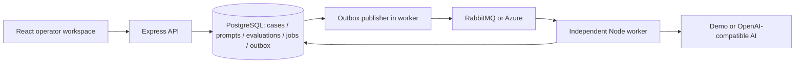

# Enterprise AI Customer Operations

**LLMOps · Event-Driven Architecture · Prompt Engineering · Distributed Systems**

A working customer operations platform for case triage, response recommendations, human review and prompt evaluation. Manual triage creates delays and inconsistent routing; this application combines asynchronous AI assistance with traceable operator decisions and measurable prompt quality.

Built as an independent software engineering portfolio project by **Keeno Smith**.

## Implemented capabilities

- Persist, search and filter customer cases; inspect recommendations, processing history and captured prompt versions.
- Correct classifications and response drafts, approve recommendations and resolve cases with a human audit trail. AI processing and operator resolution are separate states; drafts are never sent to customers.
- Process jobs with a separate Node worker through actual RabbitMQ delivery, publisher confirms, manual acknowledgements, transactional outbox, bounded retries, dead-letter archives, lease recovery and idempotent completion.
- Manage classification/response prompt drafts, compare versions and activate with a real-provider quality gate or explicit audited override.
- Queue evaluations against 36 labelled synthetic requests, inspect individual outcomes, calculate accuracy/precision/recall/macro-F1/compliance/latency and compare regressions.
- Inspect real health, worker heartbeat, jobs, retries, failures and safe replay in Operations.
- Run without AI keys using the clearly labelled deterministic demo provider; configure a Fetch-based OpenAI-compatible endpoint for real inference. Azure Service Bus is optional and contract-tested with stubs.

## Technology and architecture

React · Vite · TypeScript · Tailwind CSS · React Router · Lucide · Express · Zod · Prisma · PostgreSQL · RabbitMQ · Azure Service Bus SDK · Docker Compose · Vitest · GitHub Actions.



Delivery is at least once; durable job ownership and unique result records prevent duplicate committed outcomes. API and worker share one backend codebase. Evaluation runs use the same providers, versioned prompts and job system as business cases.

## Quick start

Requires Node.js 24 and Docker Desktop. From the repository root:

```sh
cp backend/.env.example backend/.env
cp frontend/.env.example frontend/.env
# Set your local ADMIN_TOKEN in backend/.env.
docker compose up -d --build
```

Compose migrates/seeds PostgreSQL and starts the API, worker, frontend and RabbitMQ. Open http://localhost:5173; enter `ADMIN_TOKEN` using **Operator access** in the sidebar. API: http://localhost:5050/api/health. RabbitMQ management: http://localhost:15672.

For source development:

```sh
npm ci
npm exec -w backend -- prisma generate
docker compose up -d postgres rabbitmq
npm run db:migrate
npm run db:seed
# Run each in a separate terminal:
npm run dev -w backend
npm run worker -w backend
npm run dev -w frontend
```

The environment examples default to local RabbitMQ and demo AI. Real provider configuration uses `LLM_PROVIDER`, `LLM_BASE_URL`, `LLM_API_KEY`, `LLM_MODEL`; keys stay on the backend. See [setup](docs/setup.md) for every variable, alternate ports, migrations, Azure and troubleshooting.

## Verification

```sh
npm run typecheck
npm run lint
npm test
npm run build
# Requires migrated PostgreSQL and RabbitMQ; prefer a disposable test database:
npm run test:integration
```

Locally verified on 2026-10-14: **17 backend unit/adapter tests, 6 frontend tests, 9 real PostgreSQL/RabbitMQ integration tests passed**; typecheck, lint and both production builds passed. Full Compose built and started with healthy API/database/broker/independent worker. Browser case creation → asynchronous recommendation → edited approval → resolution → refresh persistence was verified; desktop/mobile/tablet layouts were inspected. Simulation evaluation is pipeline verification, not a real model benchmark.

This Mac already has another project on default ports 5432/5050/5173. Ignored local session configuration runs this application at **http://localhost:55173**, API **55050**, PostgreSQL **55432**; committed examples retain requested defaults. Other projects were left untouched.

## Engineering documentation

- [Architecture and decisions](docs/architecture.md)
- [REST API contracts](docs/api.md)
- [Messaging, delivery and recovery](docs/messaging.md)
- [AI providers, prompt lifecycle and evaluation](docs/ai-llmops.md)
- [Setup and environment reference](docs/setup.md)
- [Tests and verification boundaries](docs/testing.md)
- [Chronological development log](docs/development-log.md)
- [Version 1 implementation report](docs/version-1-report.md)

## Status and limits

Version 1 is implemented and locally verified in demo mode. Live OpenAI-compatible inference and live Azure connectivity remain unverified because no credentials were used. Hosted GitHub Actions has not run during this local session. Azure queue depth is unavailable. Evaluation is serial within a job, and a small synthetic dataset does not establish production accuracy. The local operator token is not production identity/authorization; production needs authentication, role/tenant controls, stronger audit retention/data protection, TLS and operational monitoring. Container frontend uses Vite for the requested local development workflow.

Future work: operator identity and tenancy, customer intake integrations, larger independently labelled datasets, provider-specific structured-output compatibility, and production deployment/telemetry. Git staging, commits and pushes remain the owner's responsibility.

## Author

**Keeno Smith** — Full-Stack Software Engineer | AI Engineer
