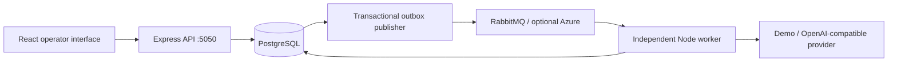

# Implemented architecture

The application has two primary source directories. `backend/src/routes` owns HTTP registration and validation; `services` owns business rules/transactions; `messaging` owns broker contracts and transport; `ai` owns providers, templates and validation; `evaluation` owns scoring; `middleware` owns API concerns. Prisma schema/migrations/seed belong in `backend/prisma`. `frontend/src` separates pages, reusable components, API communication and styles.

Case creation inserts the case, its timeline entry, processing job and outbox event in one transaction. The API does not call inference. Jobs record exact classification and response prompt IDs. Human reviews preserve before/after values separately from job inference results. UI data must come from APIs, not local sample metrics.

Prompt templates describe a purpose/kind. Versions have unique `(templateId, version)` identifiers; activation history is a separate audit table. Published and evaluated versions become immutable so later processing and evaluation can be traced to the original content.

Evaluation labels live only in dataset example records; provider inputs contain subject and description. Runs link datasets, classification prompts, response prompt IDs and provider/model identity. Each example result has a unique `(runId, exampleId)` constraint for crash recovery.

## Decisions

- **Shared backend, independent processes:** API and worker reuse services and schema without synchronous inference or duplicated domain logic.
- **PostgreSQL transactional outbox:** atomic case/job/event persistence prevents the gap between accepting a request and publishing its event. Publication is at least once.
- **Database leases and unique results:** worker ownership and transactional completion prevent duplicate committed results. Crashed leases can be recovered without assuming exactly-once message delivery.
- **Two prompt kinds:** classification and response recommendations both influence real-provider requests, with exact versions captured per job.
- **Deterministic provider:** enables an offline workflow while keeping simulated output and metrics explicitly labelled.
- **Single-operator access token:** restricts administrative writes locally; this is not a production authentication/authorization system.

## Runtime lifecycle and configuration

The API starts independently and returns health even while dependencies are unavailable. Its routes use service-boundary Zod validation, operator checks on writes, database transactions and centralized safe errors. Prisma reconnects its pool on subsequent requests. The worker retries infrastructure connection failures, claims jobs with row locks, renews ownership leases, persists results and acknowledges only after durable completion. Shutdown cancels new delivery, drains owned work and closes broker/database resources.

The frontend reads REST resources through Fetch and `hooks/useResource.ts`, polls changing operational data, and owns only form/navigation state. Operator token lives in session storage; credentials for LLM/database/broker remain backend-only. API ports, CORS, integrations, retry limits and quality gates come from validated environment configuration. Docker supplies database/broker readiness checks but runtime recovery does not depend solely on container ordering.

Case statuses distinguish New/Processing/Review/Processed/Approved/Resolved/Failed. AI processing alone never resolves a case. Reviews preserve before/after state and use optimistic updatedAt checks. All generated customer responses are drafts.

## Database constraints

Two committed migrations create relations and then strengthen prompt/replay integrity. Exact classification/response prompt IDs have foreign keys. Replay lineage has a unique successor. A SQL partial unique index permits one active prompt per template; job target and state checks guard invalid persisted lifecycle data. These PostgreSQL-specific constraints are in migration SQL because Prisma does not express partial indexes/checks completely; preserve them in future migration review.

## Verified boundary

Real PostgreSQL/RabbitMQ integration tests and full Compose startup have succeeded. Browser case creation, asynchronous processing, human approval/resolution and refresh persistence have been verified. Azure is tested with SDK stubs and real LLM HTTP is tested with Fetch stubs; neither external service was contacted. See `testing.md` and `development-log.md` for exact results and remaining limits.
